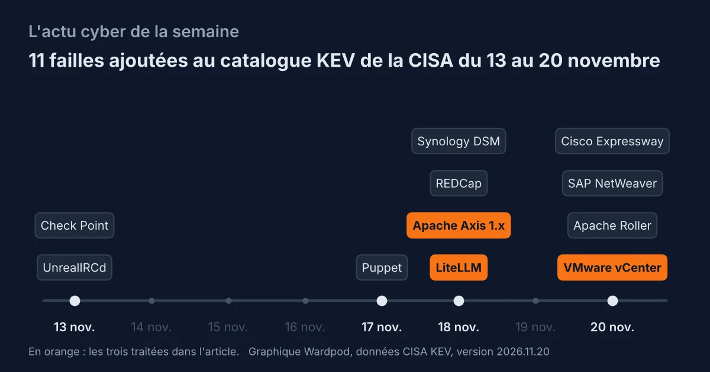
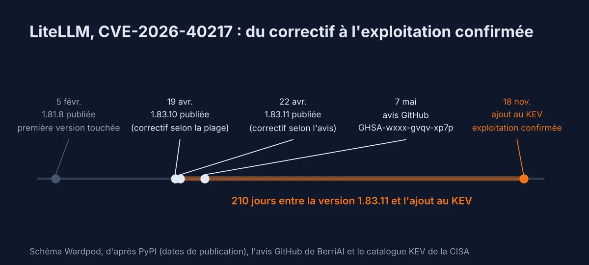

*Les onze ajouts au catalogue KEV de la semaine, par date. Graphique Wardpod, données CISA KEV du 20 novembre 2026 (version 2026.11.20).*

Trois failles touchent de près les équipes qui font tourner Kubernetes cette semaine, et toutes trois sont exploitées d'après la CISA : vCenter, qui pilote les VM des clusters installés sur vSphere, LiteLLM, un proxy vers les API de modèles de langage, et Apache Axis 1.x, une bibliothèque Java sans correctif. Entre le 13 et le 20 novembre, le [catalogue KEV de la CISA](https://github.com/cisagov/kev-data) a reçu onze entrées.

## VMware vCenter : un zero-day exploité par ARMORY CASTLE

Le 19 novembre, Google Threat Intelligence Group et Mandiant ont publié l'[analyse d'une intrusion](https://cloud.google.com/blog/topics/threat-intelligence/armory-castle-exploits-vsphere) menée par ARMORY CASTLE, anciennement suivi sous le nom UNC5221, que GTIG présente comme un « acteur d'espionnage soupçonné d'être lié à la Chine » (traduction). Le groupe a exploité CVE-2026-123890, un contournement d'authentification dans le service d'annuaire de vCenter, divulgué par VMware le jour même. Selon GTIG, l'outil BONESAW prend avec cette faille le contrôle complet des appliances vCenter 7.x et 8.x, crée un compte administrateur SSO et vole la clé de signature SAML. Les attaquants ont ensuite pris pied sur les hôtes ESXi et extrait des données des disques des VM invitées, dont des bases NTDS. La CISA a [ajouté la faille au KEV](https://github.com/cisagov/kev-data) le 20 novembre, avec une échéance au 23 novembre pour les agences fédérales.

L'[avis repris dans la base GitHub](https://github.com/advisories/GHSA-hxhc-xqhg-6gr5) affiche un CVSS 3.1 de 9,8 et donne les versions corrigées : 9.1.1.0200, 9.0.2.0200 et 8.0 U3m. Si les nœuds de vos clusters sont des VM vSphere, l'administrateur de vCenter a la main sur leurs disques, secrets compris. Appliquez le correctif de Broadcom et vérifiez que les ports que GTIG a vu scanner (9080, 5480, 2012) ne sont pas joignables hors du réseau d'administration. GTIG publie aussi des indicateurs, des règles YARA et un [outil de durcissement de l'appliance vCenter](https://github.com/mandiant/vcsa-hardening-tool) à tester avant déploiement.

## LiteLLM : une faille « modérée » ajoutée au KEV

La CISA a [ajouté CVE-2026-40217](https://github.com/cisagov/kev-data) au KEV le 18 novembre. L'[avis de BerriAI](https://github.com/BerriAI/litellm/security/advisories/GHSA-wxxx-gvqv-xp7p), publié le 7 mai, décrit une sortie du bac à sable de l'endpoint `POST /guardrails/test_custom_code`, qui exécute du code Python fourni par l'utilisateur : du bytecode forgé permet d'exécuter du code dans le processus du proxy. L'avis précise que ce processus tourne en root dans l'image Docker par défaut. BerriAI ne lui donne qu'un CVSS 4.0 de 5,9, car il faut une clé d'administration du proxy pour atteindre l'endpoint dans la configuration par défaut.


*Le correctif existe depuis avril, l'exploitation n'est confirmée que maintenant. Schéma Wardpod, d'après les dates de publication sur PyPI, l'avis GitHub de BerriAI et le catalogue KEV de la CISA.*

Les versions touchées vont de 1.81.8 à 1.83.10 exclue, mais la section « Patches » du même avis place le correctif en 1.83.11. Visez donc au moins 1.83.11 ; [PyPI](https://pypi.org/project/litellm/) en est à la série 1.110. Pour retrouver les déploiements :

```sh
kubectl get pods -A -o jsonpath='{range .items[*]}{.metadata.namespace}{"\t"}{.metadata.name}{"\t"}{.spec.containers[*].image}{"\n"}{end}' | grep -i litellm
kubectl exec -n <namespace> <pod> -- python -c "import importlib.metadata as m; print(m.version('litellm'))"
```

En attendant la mise à jour, BerriAI conseille de bloquer `POST /guardrails/test_custom_code` au niveau du reverse proxy ou de la passerelle d'API, donc dans l'Ingress ou la route qui expose le proxy. Si un proxy touché a été joignable depuis internet, changez aussi la clé d'administration.

## Apache Axis 1.x : exploitée, et pas de nouvelle version prévue

CVE-2026-90436 est entrée au [KEV](https://github.com/cisagov/kev-data) le 18 novembre. D'après la CISA, un attaquant non authentifié peut exécuter du code avec un message SOAP fault forgé qui pousse Axis à charger et instancier une classe de son choix, si une classe exploitable se trouve dans le classpath de l'application. Selon la CISA, des produits tiers qui embarquent la bibliothèque peuvent être touchés. L'[avis publié le 6 novembre](https://github.com/advisories/GHSA-988f-c54m-f8jj) indique que toutes les versions 1.x jusqu'à 1.4 sont touchées, que les gestionnaires d'authentification des services ne protègent pas, car le message est lu avant eux, et que le projet ne prévoit pas de version 1.x corrigée. Apache conseille de migrer vers Axis2/Java ou d'appliquer le commit 41f3b4e. La base GitHub affiche un CVSS 3.1 de 9,8.

La bibliothèque peut donc venir d'une application maison comme d'un logiciel tiers. Cherchez-la dans les conteneurs Java :

```sh
kubectl exec -n <namespace> <pod> -- sh -c 'find / -name "axis*.jar" 2>/dev/null'
```

Un `axis-1.4.jar` ou `axis.jar` trouvé dans un service exposé passe en tête de liste. Sans migration possible à court terme, il reste le commit d'Apache à recompiler, ou une restriction réseau stricte de l'endpoint SOAP.

## nginx2root : toujours pas au KEV

Les cinq failles d'exécution de code corrigées par nginx 1.31.9 et 1.30.7, et le cas d'ingress-nginx qui ne recevra pas de correctif, sont détaillés dans [l'article publié ce matin](/blog/2026-11-21-nginx2root-ingress-nginx-kubernetes). Aucune des cinq CVE ne figure dans la version du 20 novembre du [catalogue KEV](https://github.com/cisagov/kev-data).

## pip et certifi : la CVE des certificats eMudhra

Une CVE publiée le 20 novembre, [CVE-2026-133949](https://github.com/advisories/GHSA-jg88-vh4g-v698), vise pip avant la version 26.2.2 : le certifi embarqué dans pip contient les certificats eMudhra compromis. L'incident date d'octobre. L'[avis de certifi](https://github.com/advisories/GHSA-6q48-6c7w-9gw2), relu par GitHub le 20 octobre, explique que huit autorités intermédiaires d'eMudhra rattachées à la racine emSign ECC Root CA - G3 ont vu leurs clés privées compromises. Avec l'une de ces clés, un attaquant placé sur le chemin réseau peut émettre un certificat pour n'importe quel nom et intercepter le trafic TLS des clients qui font confiance au paquet. certifi 2026.10.18 a retiré toutes les racines emSign et 2026.10.19 a remis celles qui ne sont pas touchées. [pip 26.2.2](https://pypi.org/project/pip/26.2.2/) est sortie le 20 octobre, après la [mise à jour du certifi embarqué](https://github.com/pypa/pip/pull/14371).

Dans les images Python, regardez les deux versions :

```sh
kubectl exec -n <namespace> <pod> -- python -m pip --version
kubectl exec -n <namespace> <pod> -- python -c "import certifi; print(certifi.__version__)"
```

Le certifi de l'application compte plus que celui de pip pour le trafic de production : passez-le en 2026.10.19 ou plus récent, et pip en 26.2.2 ou plus dans les images de build.

## Les autres ajouts au KEV

Deux autres entrées peuvent concerner une équipe d'infrastructure. [Apache Roller](https://github.com/advisories/GHSA-pxp4-phq9-fx2q), de 4.0.0 à 6.1.4, désérialise des données avant authentification sur son endpoint XML-RPC : passez en 6.1.6, ou mettez `enabledForExtensions` à `false` dans `WEB-INF/web.xml` puis redémarrez (désactiver XML-RPC dans l'interface ne suffit pas). Pour Puppet Enterprise, CVE-2026-115731, la CISA décrit une exécution de code sur le Puppet Server par n'importe quel client qui détient un certificat d'agent signé, ce qui revient à une attaque sans authentification si l'autorité signe les demandes automatiquement. Le reste vise UnrealIRCd, Check Point, REDCap, Synology DSM, SAP NetWeaver et Cisco Expressway.

## À corriger en premier

1. vCenter : correctif Broadcom (9.1.1.0200, 9.0.2.0200 ou 8.0 U3m) et ports d'administration fermés.
2. LiteLLM : 1.83.11 au minimum, blocage de `/guardrails/test_custom_code` en attendant, nouvelle clé d'administration si le proxy était exposé.
3. Apache Axis 1.x : inventaire des JAR dans les images Java, puis migration, commit d'Apache ou isolement réseau.
4. nginx et ingress-nginx : la liste de [l'article de ce matin](/blog/2026-11-21-nginx2root-ingress-nginx-kubernetes).
5. Apache Roller et Puppet : version corrigée ou contournement de l'éditeur.
6. Images Python : certifi 2026.10.19 ou plus, pip 26.2.2 ou plus.

Wardpod croise le catalogue KEV, l'EPSS mis à jour chaque jour et l'exposition des workloads pour classer les vulnérabilités de vos clusters, et sa recherche dans les SBOM retrouve une bibliothèque comme Axis 1.x ou LiteLLM sur tous les clusters à la fois.

## Sources

- [Known Exploited Vulnerabilities, dépôt kev-data](https://github.com/cisagov/kev-data), CISA, version 2026.11.20 du 20 novembre 2026
- [ARMORY CASTLE exploits vSphere](https://cloud.google.com/blog/topics/threat-intelligence/armory-castle-exploits-vsphere), Google Threat Intelligence Group et Mandiant, 19 novembre 2026
- [GHSA-hxhc-xqhg-6gr5, CVE-2026-123890 (VMware vCenter)](https://github.com/advisories/GHSA-hxhc-xqhg-6gr5), GitHub Advisory Database, 19 novembre 2026
- [VCSA Hardening & Logging Tool](https://github.com/mandiant/vcsa-hardening-tool), Mandiant
- [Sandbox escape in custom-code guardrail, GHSA-wxxx-gvqv-xp7p](https://github.com/BerriAI/litellm/security/advisories/GHSA-wxxx-gvqv-xp7p), BerriAI, 7 mai 2026
- [litellm](https://pypi.org/project/litellm/), PyPI, historique des versions
- [GHSA-988f-c54m-f8jj, CVE-2026-90436 (Apache Axis 1.x)](https://github.com/advisories/GHSA-988f-c54m-f8jj), GitHub Advisory Database, 6 novembre 2026
- [GHSA-jg88-vh4g-v698, CVE-2026-133949 (pip)](https://github.com/advisories/GHSA-jg88-vh4g-v698), GitHub Advisory Database, 20 novembre 2026
- [certifi bundles emSign root CAs with compromised intermediate CA keys, GHSA-6q48-6c7w-9gw2](https://github.com/advisories/GHSA-6q48-6c7w-9gw2), GitHub Advisory Database, 20 octobre 2026
- [Upgrade certifi to 2026.10.18, pypa/pip#14371](https://github.com/pypa/pip/pull/14371), pip, 18 octobre 2026
- [pip 26.2.2](https://pypi.org/project/pip/26.2.2/), PyPI, 20 octobre 2026
- [GHSA-pxp4-phq9-fx2q, CVE-2026-129448 (Apache Roller)](https://github.com/advisories/GHSA-pxp4-phq9-fx2q), GitHub Advisory Database, 17 novembre 2026
- [nginx2root, cinq failles de nginx vues depuis un cluster Kubernetes](/blog/2026-11-21-nginx2root-ingress-nginx-kubernetes), Wardpod, 21 novembre 2026

## Crédits des images

- 2026-11-21-actu-cyber-semaine-couverture.webp : graphique Wardpod, données du catalogue KEV de la CISA, version 2026.11.20.
- 2026-11-21-actu-cyber-semaine-litellm.webp : schéma Wardpod, d'après PyPI, l'avis GHSA-wxxx-gvqv-xp7p de BerriAI et le catalogue KEV de la CISA.
