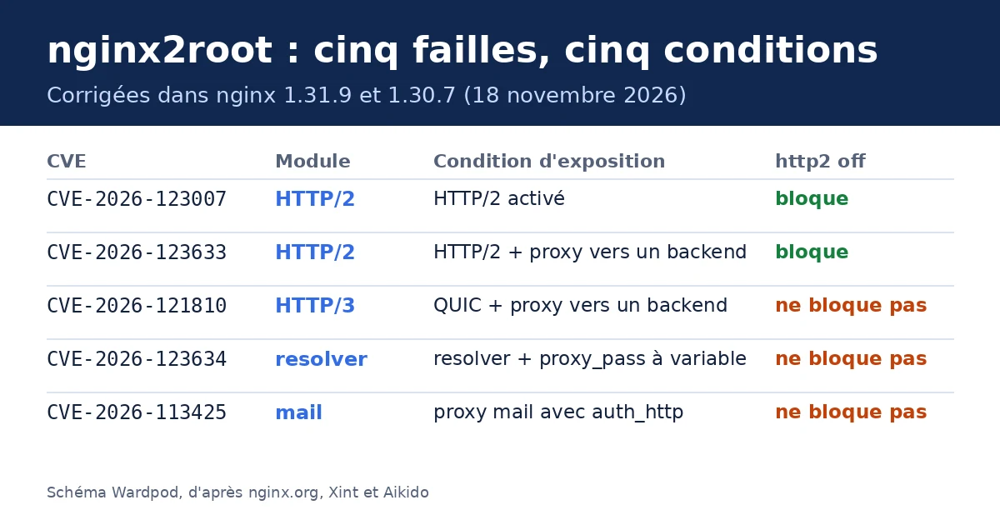
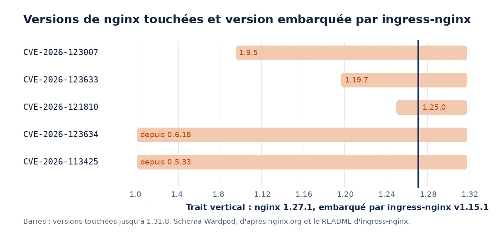

*Les cinq failles regroupées sous le nom nginx2root. Schéma Wardpod, d'après les avis de nginx.org, la publication de Xint et l'analyse d'Aikido.*

Le 18 novembre 2026, nginx a publié les versions [1.31.9 (mainline) et 1.30.7 (stable)](https://nginx.org/), qui corrigent dix vulnérabilités. Cinq d'entre elles permettent, selon les chercheurs de Xint qui les ont signalées, d'exécuter du code à distance sans authentification. Xint les a regroupées sous le nom [NGINX2Root](https://xint.io/blog/nginx2root-remote-code-execution). Dans un cluster Kubernetes, nginx tourne dans des images applicatives, des sidecars et des contrôleurs d'Ingress. Or ingress-nginx, le contrôleur d'Ingress du projet Kubernetes, n'est plus maintenu depuis mars 2026.

## Ce qui est touché

Xint précise que les cinq failles n'ont pas besoin d'être enchaînées : chacune est un chemin d'attaque à elle seule, mais chacune demande une configuration particulière. Les versions touchées viennent des [avis de sécurité de nginx.org](https://nginx.org/en/security_advisories.html), les conditions du [journal des modifications de nginx](https://nginx.org/en/CHANGES) et de l'[analyse d'Aikido](https://www.aikido.dev/blog/nginx2root-critical-nginx-rce-vulnerabilities) :

- CVE-2026-123007, corruption mémoire dans le contrôle de flux HTTP/2, touche nginx 1.9.5 à 1.31.8. Il suffit que HTTP/2 soit activé. Xint précise que le bug existe depuis l'arrivée de HTTP/2 dans nginx, en 2015.
- CVE-2026-123633, use-after-free en HTTP/2, touche 1.19.7 à 1.31.8 quand nginx relaie les requêtes vers un backend et que les emplacements de connexion (`worker_connections`) viennent à manquer.
- CVE-2026-121810 est le même défaut sur HTTP/3 (QUIC), de 1.25.0 à 1.31.8.
- CVE-2026-123634 touche le `resolver`, de 0.6.18 à 1.31.8, quand un `proxy_pass` contient une variable et que le même nom est résolu en même temps par des sous-requêtes.
- CVE-2026-113425 touche le proxy mail, de 0.5.33 à 1.31.8, avec `auth_http`.

nginx.org classe ces failles en gravité « major » ou « medium » selon le cas. Xint, de son côté, dit avoir obtenu une exécution de code sur un serveur [attaqué par son adresse IP publique chez AWS](https://xint.io/blog/nginx2root-remote-code-execution), avec des démonstrations sur GCP, Azure et du matériel nu. En enchaînant une faille avec un défaut du sous-système SCTP du noyau Linux, les chercheurs ont obtenu les droits root sur l'hôte. D'après Xint, la même chaîne est sortie d'un conteneur Docker qui exécutait nginx pour prendre la main sur la machine. Selon [CSO Online](https://www.csoonline.com/article/4250460/ai-unearths-internet-breaker-flaws-in-nginx-web-server.html), ce défaut du noyau existe depuis Linux 4.15 et n'avait ni CVE ni correctif au 18 novembre.

Plusieurs équipes ont trouvé les mêmes bugs chacune de leur côté. [BleepingComputer](https://bleepingcomputer.com/news/security/critical-nginx-nginx2root-bugs-let-attackers-hijack-servers) cite Xint, Wiz, Ikotas Labs, Metnir et Rapid7, et CSO Online indique que des chercheurs de plusieurs de ces sociétés ont trouvé une partie des failles avec des agents d'IA.

## Faut-il tout arrêter ?

Pas encore, et c'est là que la gravité affichée ne suffit pas pour décider. Pour prioriser, regardez l'exploitation réelle, la probabilité d'exploitation et l'exposition de chaque nginx :

- Au [catalogue KEV de la CISA](https://www.cisa.gov/known-exploited-vulnerabilities-catalog) (version du 20 novembre 2026), aucune des dix CVE corrigées par nginx n'apparaît. Pour les deux failles HTTP/2, CSO Online rapporte que, d'après l'évaluation de la CISA, personne ne les a encore exploitées.
- Le 20 novembre, le score [EPSS de FIRST](https://api.first.org/data/v1/epss?cve=CVE-2026-123007,CVE-2026-123633,CVE-2026-123634,CVE-2026-121810,CVE-2026-113425) était de 6,09 % pour CVE-2026-123633 et de 6,03 % pour CVE-2026-123007, au-dessus de 93 % des CVE notées. Les trois autres étaient entre 1,5 % et 1,7 %.
- Un nginx qui termine du TLS en HTTP/2 face à internet est la cible directe de CVE-2026-123007. Un nginx interne, sans HTTP/2 ni QUIC, sans `resolver` à variable ni proxy mail, n'est concerné par aucune des cinq.

Xint dit avoir retiré de sa publication les dernières étapes nécessaires pour reproduire les exploits. Mais les correctifs sont publics et plusieurs équipes ont trouvé les mêmes failles séparément : un exploit public peut arriver vite. Les nginx exposés en HTTP/2 passent donc en tête de liste. Les instances internes qui n'utilisent aucune des fonctions concernées peuvent suivre le cycle normal de mise à jour.

## Le cas ingress-nginx

Le projet Kubernetes avait [annoncé en novembre 2025](https://kubernetes.io/blog/2025/11/11/ingress-nginx-retirement/) que la maintenance d'ingress-nginx s'arrêterait en mars 2026, sans nouvelle version ni correction de vulnérabilité ensuite. Le [dépôt GitHub](https://github.com/kubernetes/ingress-nginx) est archivé depuis le 24 mars 2026. Le 5 novembre, l'équipe de sécurité de Kubernetes a d'ailleurs publié une autre CVE d'ingress-nginx [sans correctif](https://discuss.kubernetes.io/t/security-advisory-cve-2026-116472-ingress-nginx-mirror-target-self-dos/35554), en renvoyant vers la version corrigée du fork de SUSE.


*La version de nginx embarquée par la dernière version d'ingress-nginx se trouve dans les cinq plages touchées ; les conditions d'exposition de chaque faille restent à vérifier. Schéma Wardpod, d'après nginx.org et le README d'ingress-nginx.*

D'après le tableau des versions de son README, la dernière version, controller v1.15.1, embarque nginx 1.27.1. Cette version est dans la plage de CVE-2026-123007 comme dans celle de CVE-2026-123633. Aikido indique qu'ingress-nginx est vulnérable à CVE-2026-123633 et ne recevra pas de correctif, et CSO Online rapporte que Metnir a fait planter avec ce bug les binaires de plusieurs passerelles, dont ingress-nginx. Enfin, la [documentation de la ConfigMap](https://github.com/kubernetes/ingress-nginx/blob/main/docs/user-guide/nginx-configuration/configmap.md) montre que l'option `use-http2` vaut `"true"` par défaut.

## Que faire dans le cluster

Commencez par l'inventaire. Le projet Kubernetes donne cette commande pour repérer ingress-nginx (droits d'administrateur du cluster nécessaires) :

```sh
kubectl get pods --all-namespaces --selector app.kubernetes.io/name=ingress-nginx
```

Pour les autres conteneurs qui embarquent nginx, listez les images en service :

```sh
kubectl get pods -A -o jsonpath='{range .items[*]}{.metadata.namespace}{"\t"}{.metadata.name}{"\t"}{.spec.containers[*].image}{"\n"}{end}' | grep -i nginx
```

Lisez ensuite la version dans un conteneur avec `kubectl exec -n <namespace> <pod> -- nginx -v`. Les paquets des distributions peuvent recevoir un correctif sans changer de numéro de version amont : pour une image basée sur Debian, Ubuntu ou Alpine, vérifiez aussi l'avis de sécurité de la distribution.

Selon ce que vous trouvez :

- Images nginx officielles ou maison : passez à 1.31.9 ou 1.30.7 et redéployez. Pour un nginx installé directement sur des nœuds ou des VM, [ArmorCode](https://www.armorcode.com/blog/nginx2root-critical-nginx-rce) rappelle qu'un rechargement de configuration ne remplace pas le binaire en cours d'exécution : il faut redémarrer le service.
- ingress-nginx : en attendant la migration, coupez HTTP/2 dans la ConfigMap du contrôleur (`use-http2: "false"`), ce qui bloque CVE-2026-123007 et CVE-2026-123633. Les clients repassent en HTTP/1.1. Planifiez ensuite le passage à un contrôleur maintenu ou à la Gateway API.
- `resolver` avec un `proxy_pass` à variable : Aikido conseille de pointer `proxy_pass` vers un groupe `upstream` fixe jusqu'à la mise à jour.
- HTTP/3 : retirez les écoutes QUIC et mettez `http3 off;`.
- Proxy mail : limitez ses écoutes à l'adresse de bouclage ou à des IP de confiance.

Côté détection, ArmorCode conseille de surveiller les processus nginx qui lancent un shell ou un autre programme, et les plantages répétés de workers (signal 11).

Wardpod classe ce type de vulnérabilité selon l'exposition réelle : une image nginx joignable depuis internet par un Ingress ou un LoadBalancer remonte avant la même image restée interne, et l'inventaire des SBOM retrouve en une recherche toutes les images qui embarquent nginx sur l'ensemble de vos clusters.

## Sources

- [nginx news, annonce de nginx 1.30.7 et 1.31.9](https://nginx.org/), nginx.org, 18 novembre 2026
- [nginx security advisories](https://nginx.org/en/security_advisories.html), nginx.org
- [CHANGES, nginx 1.31.9](https://nginx.org/en/CHANGES), nginx.org, 18 novembre 2026
- [NGINX2Root: New Remote Code Execution Vulnerabilities in nginx Require Urgent Patching](https://xint.io/blog/nginx2root-remote-code-execution), Xint, 18 novembre 2026
- [AI unearths ‘internet breaker’ flaws in Nginx web server](https://www.csoonline.com/article/4250460/ai-unearths-internet-breaker-flaws-in-nginx-web-server.html), Lucian Constantin, CSO Online, 18 novembre 2026
- [Article de Bill Toulas sur les failles nginx2root](https://bleepingcomputer.com/news/security/critical-nginx-nginx2root-bugs-let-attackers-hijack-servers), Bill Toulas, BleepingComputer, 19 novembre 2026
- [nginx2root: Critical nginx RCE vulnerabilities and how to fix them](https://www.aikido.dev/blog/nginx2root-critical-nginx-rce-vulnerabilities), Aikido, 18 novembre 2026
- [nginx2root: What You Need to Know About the 5 Critical nginx RCEs](https://www.armorcode.com/blog/nginx2root-critical-nginx-rce), ArmorCode, 19 novembre 2026
- [Known Exploited Vulnerabilities Catalog](https://www.cisa.gov/known-exploited-vulnerabilities-catalog), CISA, version 2026.11.20
- [API EPSS](https://api.first.org/data/v1/epss?cve=CVE-2026-123007,CVE-2026-123633,CVE-2026-123634,CVE-2026-121810,CVE-2026-113425), FIRST, scores du 20 novembre 2026
- [Ingress NGINX Retirement: What You Need to Know](https://kubernetes.io/blog/2025/11/11/ingress-nginx-retirement/), Kubernetes, 11 novembre 2025
- [kubernetes/ingress-nginx](https://github.com/kubernetes/ingress-nginx), dépôt GitHub archivé, README (tableau des versions)
- [ConfigMap d'ingress-nginx, option use-http2](https://github.com/kubernetes/ingress-nginx/blob/main/docs/user-guide/nginx-configuration/configmap.md), documentation d'ingress-nginx
- [Security Advisory CVE-2026-116472: ingress-nginx mirror-target self-DOS](https://discuss.kubernetes.io/t/security-advisory-cve-2026-116472-ingress-nginx-mirror-target-self-dos/35554), équipe de sécurité de Kubernetes, discuss.kubernetes.io, 5 novembre 2026

## Crédits des images

- 2026-11-21-nginx2root-couverture.webp : schéma Wardpod, données nginx.org, Xint et Aikido.
- 2026-11-21-nginx2root-ingress-nginx.webp : schéma Wardpod, données nginx.org et README d'ingress-nginx.
